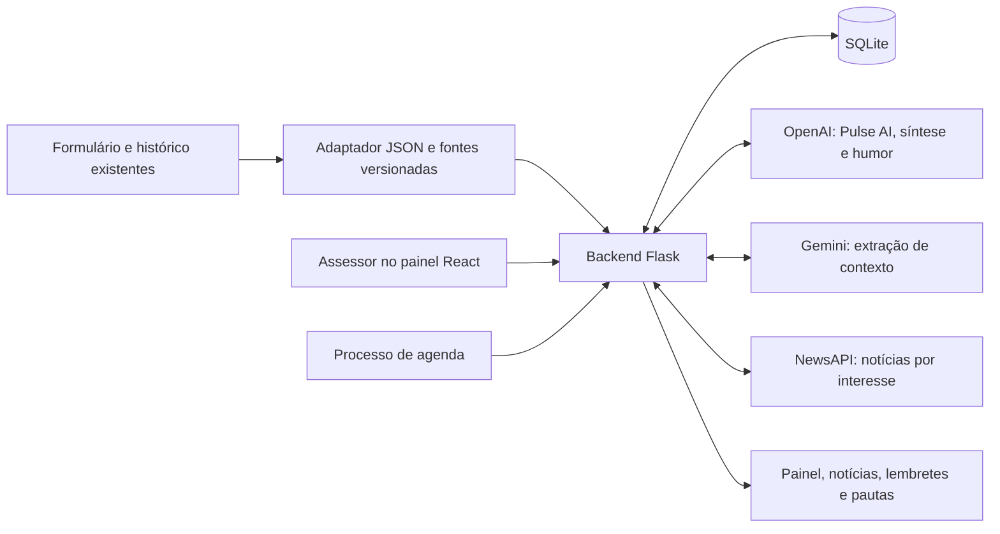

# XP Pulse — atendimento personalizado com contexto


**Pulse ajuda o assessor a acompanhar o ritmo de cada investidor.** Reúne carteira, conversas, interesses, percepção do relacionamento, notícias e preparação de reuniões em um painel web responsivo. O objetivo é poupar tempo de busca e melhorar a relação com o cliente, preservando a decisão final do assessor.

Projeto do **grupo 1**, desenvolvido no hackathon **Rota XP**, com aproximadamente **6h30 de trabalho**. Este README concentra a documentação do projeto: proposta, processo, equipe, arquitetura, funcionalidades, instalação, testes e limites da versão.

## Proposta e diferencial

O assessor precisa combinar informações financeiras com o contexto pessoal do investidor. Essas informações costumam estar distribuídas em formulários, ligações, e-mails, WhatsApp e notas de reuniões.

O Pulse parte da premissa de que essas fontes já existem. O MVP usa um adaptador JSON para representar sua ingestão, preservando origem, identidade, versão e evidências. Também permite que o assessor acrescente informações diretamente no **Pulse AI** ou no campo de interesses das notícias.

O diferencial proposto é aproximar contexto financeiro e relacionamento: preparar uma conversa pertinente, lembrar preferências e identificar assuntos relevantes sem exigir que o assessor reconstrua todo o histórico. A solução dá apoio ao profissional; a decisão de abordar um assunto, entrar em contato ou recomendar qualquer ação continua com ele.

## Como organizamos o desenvolvimento

1. Após a apresentação da proposta, colocamos todas as ideias em pauta e selecionamos as que mais faziam sentido para o MVP e o tempo disponível.
2. Organizamos as atividades em **Kanban** e dividimos o trabalho em frontend e backend conforme a aptidão de cada integrante.
3. Estruturamos requisitos, regras, contratos, critérios de aceite e etapas usando **SDD — Specification-Driven Development**.
4. Utilizamos **TDD — Test-Driven Development** para orientar regras e comportamentos: escrever o teste, implementar a solução e corrigir/refinar até atender ao comportamento esperado.
5. Integramos as entregas, testamos os fluxos e corrigimos os erros identificados. Na reta final, também utilizamos testes de regressão e verificações dirigidas para as correções do MVP.

**SDD e TDD foram utilizados no desenvolvimento.** A especificação guiou os incrementos; os testes ajudaram a validar regras, integrações, persistência e regressões. Os documentos intermediários foram consolidados neste README; seu histórico permanece no Git.

### Equipe e responsabilidades

| Integrante | Responsabilidades na divisão de trabalho |
| --- | --- |
| **Antonio Adolfo Geraldino Bernardo** | Estruturação do SDD, funcionamento das rotas do backend e documentação. |
| **Felipe Cruzato Yacobian** | Design do site, prototipação, revisão de código, logo e imagens; escolha do framework frontend. |
| **Marco Antônio da Cruz Braga** | Prototipação, estrutura do design e colaboração no frontend, incluindo criação de interfaces. |
| **Marcus Vinícius Santos** | Funcionalidades como radar, card do cliente com prioridade e humor, e testes. |
| **Pedro Azevedo** | Automatização dos testes, colaboração na estruturação do design, deploy e refino do frontend. |
| **Pedro Bernardo** | Integração das APIs de notícias e Google Calendar e suas respectivas funcionalidades, colaboração no backend e criação dos slides para o pitch. |

A tabela registra a divisão de responsabilidades informada pela equipe. **Nesta versão do repositório, a agenda implementada é local, em SQLite; não há um conector Google Calendar implementado no código inspecionado.** A preparação de reuniões funciona com essa agenda local.

### Ferramentas de apoio

Foram utilizados **Claude Code, Codex e Gemini** no desenvolvimento, na prototipação e nas revisões, com integração e avaliação das entregas pela equipe. **A logo foi gerada com Nano Banana, no Gemini.** Essas ferramentas de criação são distintas das APIs que a aplicação utiliza durante sua execução.

## Nome, logo e identidade visual

**Pulse** faz referência a pulso, ritmo e acompanhamento contínuo. Cada investidor tem seu próprio ritmo: objetivos, preferência de contato, momentos de atenção e assuntos que tornam a conversa mais próxima. O nome expressa a proposta de perceber esse ritmo e oferecer um atendimento personalizado.

A logo combina a referência **XP**, o nome **Pulse** e um traço de pulsação à direita. O símbolo amarelo e o contraste com a tipografia branca dialogam com a identidade visual da XP. A onda remete ao acompanhamento e à continuidade do relacionamento; a leitura visual é a de uma solução que acompanha o pulso do cliente. Essa é a interpretação da proposta visual adotada pela equipe.

Na interface, o fundo escuro, os detalhes amarelos, os cards e a hierarquia tipográfica favorecem a leitura rápida. A identidade do assistente é **Pulse AI**. Logo e elementos visuais estão em `frontend/src/assets/`; as fotos de apresentação dos clientes ficam em `frontend/public/assets/avatars/` e são servidas localmente.

## Funcionalidades desta versão

| Área | Comportamento implementado |
| --- | --- |
| Clientes | Lista de dez perfis de demonstração, fotos, busca por nome/interesses e filtros por humor inferido. |
| Carteira | Total com precisão decimal, posições e fontes, perfil cadastrado, objetivo e distribuição por valor agrupada pelo tipo dos ativos. |
| Radar | Estimativa heurística de risco, crédito privado, liquidez, horizonte e diversificação; compara o perfil declarado com o sugerido pela carteira. |
| Relacionamento | Histórico de avaliações do assessor, preferências de canal e cadência, interações e próximos passos. |
| Humor | Inferência OpenAI baseada nas interações com o investidor, com trechos de evidência e possibilidade de revisão pelo assessor. |
| Pulse AI | Conversa natural com contexto do cliente; registra automaticamente informações declaradas pelo assessor e atualiza o painel. |
| Notícias | NewsAPI por interesses identificados, inclusive assuntos fora do catálogo inicial; adicionar um interesse no chat ou no campo de notícias dispara atualização automática. |
| Curadoria | O assessor pode remover notícias que não forem pertinentes; não precisa anexá-las ao cliente. |
| Reuniões | Agendamento, edição, cancelamento, notas e pautas/keynotes com fontes; conclusão registra o resultado sem duplicar a interação. |
| Lembranças | Aniversários e compromissos com evidência, confirmação e feedback por ocorrência. |
| Acesso | Login, sessão, proteção CSRF nas escritas e logout. |

A prioridade de atendimento vem das regras de pendências, separada do humor e da avaliação manual de relacionamento. O cálculo de alertas permanece no backend, embora o bloco “Alertas e vencimentos” tenha sido retirado da interface. A importação visual de fontes também foi retirada; a ingestão continua disponível por CLI/API.

**Humor não é inferido de notícias ou resultados esportivos.** Ele usa as conversas entre assessor e investidor. O radar é uma heurística sobre as posições, não um modelo de suitability ou uma recomendação de investimento.

## Arquitetura e fluxo de dados



1. Fontes existentes são importadas com identificação e versão; conversas ficam associadas ao cliente.
2. O backend calcula regras determinísticas e organiza a leitura do painel. A extração Gemini, quando acionada, propõe contexto com evidências.
3. O Pulse AI recebe um conjunto limitado de informações do cliente e o histórico recente do chat. Informações declaradas pelo assessor são salvas com referência à mensagem original.
4. Ao salvar novos interesses pelo chat ou pela seção de notícias, o frontend solicita a coleta e relê o painel. O interesse permanece salvo mesmo se o provedor de notícias falhar; a interface informa o erro.
5. Notícias são buscadas por assunto e reaproveitadas entre clientes. O descarte é específico de cada cliente.
6. Um processo separado acompanha a agenda e prepara pautas das reuniões próximas, reutilizando as fontes e as coletas disponíveis.

Consultas de leitura (`GET`) não chamam os provedores de IA ou notícias. As atualizações são escritas explícitas (`POST`) ou tarefas do processo de agenda. O painel pode disparar essas escritas automaticamente quando identifica dados pendentes.

## Tecnologias utilizadas

| Tecnologia | Uso no código e motivo da escolha |
| --- | --- |
| **Python 3.13 + Flask 3** | API, regras, integração com provedores e comandos de operação; estrutura pequena e rápida de implementar no prazo. |
| **SQLite** | Persistência local de clientes, interações, carteira, contexto, reuniões, sessões, caches e feedback; dispensa um servidor de banco adicional. |
| **uv + `uv.lock`** | Ambiente e dependências Python reproduzíveis. |
| **React 19 + TypeScript** | Componentes do painel e contratos tipados, facilitando divisão do frontend e integração com a API. |
| **Tailwind CSS 4 + Vite 8** | Estilização consistente, desenvolvimento rápido e geração do frontend para ser servido pelo Flask. |
| **Node.js + npm** | Ferramentas de build e testes do frontend; Node.js não é o servidor principal do backend. |
| **OpenAI — API Responses** | Conversa do Pulse AI, síntese textual e inferência de humor, com saídas estruturadas e validação de fontes. |
| **Gemini — API Generative Language** | Extração de interesses, objetivos, preferências e outros contextos a partir das fontes. Modelo configurável. |
| **NewsAPI.org** | Busca de artigos por assuntos pertinentes ao cliente. |
| **pytest** | Testes de regras, rotas, acesso, persistência e integrações simuladas. |
| **Node test runner + Oxlint** | Testes e lint do frontend; TypeScript valida tipos durante o build. |
| **Git, GitHub e GitHub Actions** | Integração das entregas e execução de testes, lint e build na CI. |
| **Lucide React + clsx** | Ícones e composição de classes da interface. |

As dependências efetivas estão em `backend/pyproject.toml`, `backend/uv.lock`, `frontend/package.json` e `frontend/package-lock.json`. Não foi adotado um banco NoSQL. O backend possui ferramentas de CSS para a interface anterior, preservada em `/legacy`; o frontend principal é React.

## Decisões de eficiência

- **MVP por incrementos:** priorizamos o fluxo de atendimento e a apresentação; cada entrega acrescentou um comportamento verificável.
- **Aplicação local e banco único:** Flask e SQLite reduzem infraestrutura, configuração e tempo de integração entre os integrantes.
- **Regras antes de IA:** valores, prazos, prioridade e composição usam regras determinísticas. A IA é usada onde ajuda a interpretar ou redigir, com evidências.
- **Precisão financeira:** dinheiro é armazenado como texto e calculado com `Decimal`; o frontend preserva valores monetários grandes sem convertê-los indiscriminadamente em `float`.
- **Cache por assunto:** clientes com o mesmo interesse reutilizam a coleta. A busca manual/automática após inclusão de interesse reaproveita resultados muito recentes, em uma janela de dois minutos.
- **Coleta diária e antecipação:** o processo de agenda roda, por padrão, a cada 60 segundos; pode antecipar atualização de notícias com cache de duas horas ou mais para reuniões nas próximas 24 horas.
- **Orçamento e concorrência:** há limite diário local, controle de chamadas simultâneas, tratamento de indisponibilidade e intervalo entre novas tentativas. A quota do provedor também se aplica.
- **Contexto limitado e cache de IA:** histórico recente, limite de entradas e assinaturas dos dados evitam chamadas desnecessárias para fatos que não mudaram. Nas chamadas OpenAI, é usado `store: false`.
- **Idempotência:** repetir uma importação, uma carga de demonstração ou a conclusão de uma reunião não deve duplicar os registros correspondentes.
- **Assets locais:** fotos e logo acompanham o projeto; seu carregamento não depende de um serviço externo de imagens.

## Organização das pastas

```text
.
├── README.md                   # Documentação única do projeto
├── iniciar.py                  # Inicializador da demonstração
├── apresentacao/
│   └── Pitch_RotaXP.pdf         # Material do pitch
├── .github/workflows/ci.yml     # Testes, lint e build no GitHub Actions
├── backend/
│   ├── app/                    # Flask, rotas, regras, integrações e persistência
│   │   ├── api.py              # Rotas de negócio
│   │   ├── pulse.py            # Dados do painel React
│   │   ├── db.py               # Schema SQLite e acesso ao banco
│   │   ├── clock.py            # Referência única de tempo: America/Sao_Paulo
│   │   ├── chat.py             # Conversa e notas do Pulse AI
│   │   ├── contexto*.py        # Contexto, evidências e revisões
│   │   ├── ia_*.py             # Adaptadores OpenAI e Gemini
│   │   ├── noticias*.py        # Regras, cache e curadoria das notícias
│   │   ├── newsapi.py          # Cliente do provedor de notícias
│   │   ├── reunioes.py         # Agenda e pautas
│   │   ├── lembrancas.py       # Datas e feedback
│   │   ├── humor.py            # Inferência com evidências das interações
│   │   ├── seed.py             # Carga inicial
│   │   ├── demo_pulse.py       # Carga ampliada de dez clientes
│   │   └── templates/, static/ # Interface anterior, em /legacy
│   ├── dados/                  # Fontes de demonstração para importação
│   ├── tests/                  # Testes Python
│   ├── instance/               # Banco local e dados de execução; fora do Git
│   ├── .env.example            # Exemplo de configuração sem segredos
│   ├── pyproject.toml
│   └── uv.lock
└── frontend/
    ├── src/
    │   ├── features/           # Clientes, Pulse AI, notícias, agenda e lembretes
    │   ├── components/         # Componentes compartilhados e layout
    │   ├── hooks/              # Busca de recursos, filtros e estado
    │   ├── lib/                # API, autenticação, formatação e radar
    │   ├── types/              # Tipos dos dados e contratos
    │   └── assets/             # Logo e elementos da identidade visual
    ├── public/assets/avatars/  # Fotos locais
    ├── tests/                  # Testes do frontend
    ├── dist/                   # Build gerado, fora do Git
    └── package.json
```

Os módulos `*_rules.py` concentram regras testáveis sem depender das rotas. Os demais módulos coordenam banco, HTTP e serviços externos. A estrutura de código foi preservada para evitar mudanças de imports ou quebra das funcionalidades durante a consolidação da documentação. `material-local/`, quando presente, contém materiais pessoais e não é necessário para executar o projeto.

## Executar

Requisitos: **Python 3.13 gerenciado pelo uv**, **uv** e **Node.js 22.18+ ou 24+**, com npm. Execute na raiz:

```bash
uv run --locked --project backend iniciar.py
```

O inicializador instala as dependências do frontend, compila a interface, inicializa a base, importa fontes e carrega os dez clientes sem apagar os registros existentes. Também inicia Flask e o processo de agenda. Na primeira execução, cria `backend/.env` a partir do exemplo, se esse arquivo não existir.

Acesse **http://127.0.0.1:5001/login**. Login de demonstração: **`admin` / `admin`**. Não há recuperação de senha. Para reutilizar um build já existente:

```bash
uv run --locked --project backend iniciar.py --sem-build
```

A porta pode ser definida com `--porta 5002`. Não execute dois servidores na mesma porta.

### Configuração das APIs

Preencha apenas as integrações utilizadas em `backend/.env`. Esse arquivo não é versionado; as chaves não devem ir para o frontend.

| Variável | Finalidade |
| --- | --- |
| `OPENAI_API_KEY` | Pulse AI, síntese e humor. |
| `OPENAI_MODEL` | Modelo OpenAI; padrão do código: `gpt-4.1-mini`. |
| `GEMINI_API_KEY` | Extração de contexto das fontes. |
| `GEMINI_MODEL` | Modelo Gemini configurável; confira o exemplo e a disponibilidade na sua conta. |
| `NEWSAPI_API_KEY` | Busca de notícias; `NEWSAPI_KEY` também é aceito como alias. |
| `NEWSAPI_LIMITE_DIARIO` | Teto local de consultas, de 1 a 100; padrão do repositório: 20. A instalação usada na demonstração foi ajustada para 50. |
| `SECRET_KEY` | Segredo de assinatura da sessão; mantenha privado. |

Reinicie os processos após alterar o `.env`. Sem chaves, os registros locais continuam disponíveis, mas as funcionalidades dependentes do provedor exibem seu estado de configuração. Modelos e quotas dependem das credenciais e da conta utilizada.

### Desenvolvimento separado

Backend, em um terminal:

```bash
cd backend
uv sync --locked
uv run --locked flask --app app run -p 5001
```

Frontend, em outro terminal:

```bash
cd frontend
npm ci
npm run dev
```

O Vite roda em `127.0.0.1` e encaminha `/api` ao Flask na porta 5001. O build completo é servido pelo próprio Flask.

### Operação e dados

Execute dentro de `backend/`:

```bash
uv run --locked flask --app app seed
uv run --locked flask --app app importar-fontes dados/fonte-demo.json
uv run --locked flask --app app popular-pulse
uv run --locked flask --app app coletar-noticias
uv run --locked flask --app app acompanhar-agenda
```

`seed` popula somente a base vazia. `popular-pulse` acrescenta o cenário de dez clientes e pode ser repetido sem duplicações. `acompanhar-agenda --uma-vez` executa um único ciclo; sem essa opção, o processo precisa permanecer aberto para as atualizações periódicas.

A carga ampliada inclui cinco conversas novas por cliente, carteiras, formulários, interesses, contatos de apresentação, reuniões e aniversários. As marcações de demonstração são preservadas internamente, embora não apareçam nos textos do painel. As fotos são retratos ilustrativos locais, não dados biométricos de investidores integrados ao sistema.

O comando `reset-demo` **apaga a base local** e reconstrói o cenário inicial. Depois dele, execute novamente a importação e `popular-pulse` se quiser recuperar o cenário ampliado.

## API e persistência

As APIs de dados exigem sessão. Escritas exigem o header `X-CSRF-Token`, obtido pela sessão/autenticação. Entradas inválidas retornam erro com identificação do campo.

| Rotas principais | Uso |
| --- | --- |
| `GET /api/auth/sessao`, `POST /api/auth/login`, `POST /api/auth/logout` | Sessão, acesso e saída. |
| `GET /api/pulse` | Painel consolidado. |
| `GET /api/clientes`, `GET /api/clientes/<id>` | Clientes e detalhes. |
| `GET/POST /api/pulse/clientes/<id>/chat` | Histórico e conversa do Pulse AI; envio usa `pergunta` e `request_id`. |
| `POST /api/pulse/clientes/<id>/humor` | Inferência de humor das interações. |
| `POST /api/pulse/clientes/<id>/resumo-ia` | Síntese com fontes. |
| `GET /api/clientes/<id>/noticias` | Notícias e estado da coleta. |
| `POST /api/clientes/<id>/noticias/atualizar` | Atualização sem corpo de requisição. |
| `POST /api/clientes/<id>/noticias/descartar` | Remoção por cliente com `artigo_id` e `motivo`. |
| `POST /api/fontes/importar` | Lote versionado de formulários/interações. |
| `GET /api/clientes/<id>/contexto`, `POST /api/clientes/<id>/contexto/processar` | Contexto e extração. |
| `POST /api/clientes/<id>/interacoes` | Contato e próximos passos. |
| `POST /api/clientes/<id>/relacionamento`, `PATCH /api/clientes/<id>/preferencias` | Avaliação manual e preferências. |
| `GET /api/reunioes`, `GET/POST /api/clientes/<id>/reunioes` | Agenda geral e por cliente. |
| `POST /api/reunioes/<id>/preparar`, `/revisar`, `/concluir` | Preparação, revisão e resultado da reunião. |
| `GET/POST /api/clientes/<id>/lembrancas` | Datas confirmadas e lembretes. |
| `POST /api/clientes/<id>/lembrancas/<lembranca_id>/feedback` | Concluir, adiar ou descartar uma ocorrência. |

Rotas auxiliares de revisão e compatibilidade permanecem em `backend/app/api.py`. Na versão atual, a interface não exige anexar notícias manualmente nem confirmar cada informação declarada no chat.

O SQLite armazena registros de origem, versões, contexto, revisões, histórico, carteira, agenda e caches. Alertas são calculados sob demanda; o tratamento de uma ocorrência é persistido. Datas são armazenadas em UTC; regras recebem a referência de `clock.py`, no fuso `America/Sao_Paulo`.

## Testes e qualidade

```bash
cd backend
uv run --locked pytest
cd ../frontend
npm test
npm run lint
npm run build
```

Os testes cobrem regras de prioridade, precisão financeira, contratos, login/CSRF, fontes versionadas, contexto, conversa, humor, notícias, reuniões, lembretes e repetição sem duplicações. Provedores são simulados nos testes para verificar comportamento sem gastar chamadas externas. Os testes de frontend incluem autenticação, comunicação com a API, formatação e radar.

Na consolidação desta documentação, a suíte completa do backend passou com **387 testes**. A verificação mais recente do frontend passou com **23 testes**, lint e build. Essas contagens representam a versão verificada, não uma garantia de cobertura integral.

A CI em `.github/workflows/ci.yml` executa pytest no backend e testes, lint e build no frontend. O build também faz a checagem TypeScript. Verificações reais realizadas durante o desenvolvimento incluíram chat, coleta de notícias e atualização automática após inclusão de interesse; no navegador, também foi conferida a recuperação do painel após corrigir a formatação da data de cadastro.

## Escopo e cuidados com os dados

A aplicação é um MVP de demonstração com um assessor e login compartilhado. Não envia WhatsApp, e-mails, ligações ou ordens de investimento. Os canais são representados por fontes importadas; conectores reais exigem adaptação ao contrato da origem dos dados.

A arquitetura considera privacidade e princípios da LGPD ao separar credenciais, manter evidências e permitir correções/feedback. Isso não representa uma certificação de conformidade: uso com dados reais depende de consentimento/base legal aplicável, controle de acesso individual, retenção e exclusão, infraestrutura segura e avaliação do fluxo de dados enviado aos provedores.

Notícias dependem de disponibilidade, atraso, quotas e cobertura da NewsAPI; um interesse salvo pode não ter artigos recentes. O humor é uma hipótese apoiada em trechos. O radar não substitui a análise de risco ou suitability. Integração efetiva com Google Calendar, acesso multiassessor, canais reais e análises tributárias ficam para evolução da solução.

## Apresentação

O material do pitch está em [apresentacao/Pitch_RotaXP.pdf](apresentacao/Pitch_RotaXP.pdf). A demonstração deve destacar o fluxo: escolher um cliente, entender o contexto, conversar com o Pulse AI, acrescentar um interesse, observar notícias pertinentes e preparar a próxima reunião.
