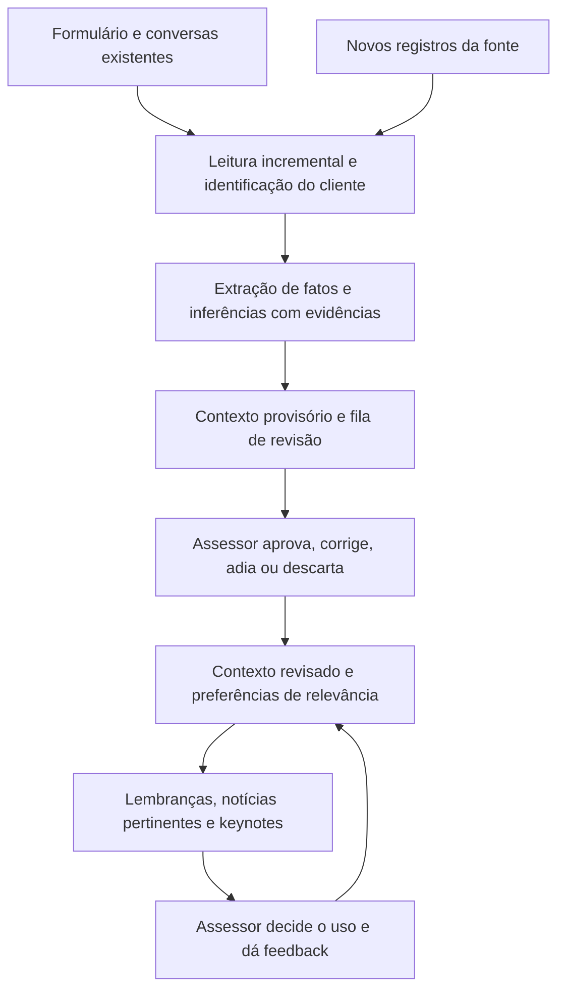

# Contexto do investidor, lembranças e feedback

**Direção definida em 10/10/2026:** partir do formulário inicial e das conversas
já disponíveis. Extrair contexto, sugerir o que vale lembrar e permitir que o
assessor decida o que é pertinente. Extração e revisão persistida implementadas
no [incremento 02](../planejamento/incrementos/02-contexto-revisao.md), com testes
de provedor simulado e uma chamada real com dados fictícios. Lembranças derivadas e
seleção de notícias ainda são propostas. A entrada de fontes JSON fictícias e consulta de
evidências versionadas estão implementadas no [incremento 01](../planejamento/incrementos/01-fontes.md).

## 1. O que já existe por premissa

- Formulário preenchido pelo investidor no início do relacionamento.
- Transcrições de ligações, e-mails e mensagens de WhatsApp Business.
- Um local de onde esses registros podem ser lidos pelo nosso sistema.

Precisamos definir o contrato de acesso, não construir o formulário nem gravar
ou transcrever ligações no MVP. Essa premissa não confirma que já recebemos
credenciais, schema ou uma fonte tecnicamente acessível.

Para demonstração, uma fonte fictícia pode simular os registros que receberíamos.
O adaptador é a parte substituível que lê API, exportação ou banco, conforme o
formato disponibilizado pela equipe.

## 2. O que extrair e inferir

| Categoria | Exemplo fictício | Tratamento |
| --- | --- | --- |
| Fato explícito | Formulário informa aniversário em 12/10 | Preservar campo, origem e data; mostrar eventuais conflitos |
| Interesse explícito | “Gosto de acompanhar Fórmula 1” | Propor interesse associado à evidência |
| Interesse inferido | Várias conversas mencionam uma modalidade esportiva | Mostrar como hipótese a revisar |
| Preferência | “Prefiro e-mail e só assuntos financeiros” | Evidenciar restrição e aplicá-la à seleção de sugestões |
| Data de outra pessoa | “Minha filha faz aniversário em novembro” | Identificar sujeito; não inventar o dia nem atribuir ao cliente |
| Compromisso | “Retomamos esse assunto na próxima semana” | Propor acompanhamento; confirmar data se insuficiente |
| Relacionamento | “Ainda não recebi o retorno que combinamos” | Sugerir atenção com trecho de origem; assessor avalia |

Campos propostos para cada item: cliente, categoria, valor, pessoa referida,
evidência/campo original, origem, data, tipo explícito/inferido, estado de revisão,
validade, versão e autor da correção quando houver.

Frequência de menções pode ajudar a ordenar hipóteses, mas não confirma preferência.
O formulário pode ficar desatualizado; conversas podem conter negação, ironia,
texto encaminhado, fala do assessor ou menção a terceiros. Contradições devem
aparecer para revisão em vez de selecionar silenciosamente uma versão.

## 3. Processamento proposto

Identificar pelo vínculo fornecido pela fonte; nome parecido não basta para
juntar históricos. Registros ambíguos ficam pendentes. Guardar identificador e
versão de origem para evitar importação e análise duplicadas.

Gemini configurável realiza a extração em formato estruturado. Validar campos e referências
no backend antes de exibir. Conteúdo de conversas é dado de análise, não instrução
para a ferramenta executar ações. Processar apenas novidades e contexto necessário.

## 4. Lembranças com propósito

Uma sugestão deve responder:

- O que lembrar e a quem isso se refere?
- Por que seria pertinente agora?
- Qual conversa ou campo sustenta a sugestão?
- Há preferência ou feedback que indique não abordar esse assunto?
- Isso ainda está válido ou já foi resolvido?

Aniversários podem ter recorrência anual após validação da data. Outros eventos
são pontuais e expiram. Evitar reapresentar lembrete já tratado no mesmo período.
Uma data sem precisão suficiente vira pergunta para confirmar, não aviso de aniversário.

**Proposta de supervisão:** o sistema prepara sugestões e notificações internas.
O assessor decide o uso no contato. Nenhuma lembrança provoca mensagem automática
ao investidor. Temas íntimos sem relação clara com o atendimento devem ter pertinência
avaliada antes de integrar lembretes. O [incremento 08](../planejamento/incrementos/08-lembrancas.md)
implementa confirmação explícita de data/tipo/descrição sobre fato revisado do
cliente ou familiar. Aniversário guarda apenas dia/mês, sem nome de familiar.
Fonte/revisão e feedback persistidos por ocorrência; mudança da fonte ou bloqueio
retira elegibilidade. Uma nova anotação não herda feedback de outra versão.

## 5. Feedback que melhora o contexto

| Ação do assessor | Efeito proposto |
| --- | --- |
| Confirmar informação | Marca a extração como revisada, com autoria e data |
| Corrigir informação | Preserva a origem e registra o valor corrigido e motivo |
| Relevante | Favorece sugestões semelhantes para esse cliente, dentro das preferências |
| Irrelevante nesta ocasião | Descarta a sugestão e evita repeti-la; mantém o interesse |
| Adiar | Define quando a mesma pendência pode reaparecer |
| Não abordar este assunto | Bloqueia o assunto para esse cliente até revisão |
| Informação incorreta | Invalida a extração e solicita revisão do contexto afetado |

O escopo do feedback deve ser explícito: item, assunto ou preferência do cliente.
Confirmar que um interesse existe não equivale a autorizar contato sobre ele.
Não receber feedback não implica aprovação nem rejeição.

No MVP, “melhorar” pode significar armazenar essas decisões e aplicá-las nas regras
de seleção e no contexto enviado à IA. Não exige retreinar modelo. Pesos e limites
de priorização são propostas a validar; manter opção de revisar/desfazer feedback.

## 6. Reuniões e notícias

Antes da reunião, combinar contexto revisado, pendências e notícias pertinentes.
Hipóteses não confirmadas aparecem como pontos a validar, fora dos fatos confirmados.
Bloqueios de assunto valem tanto para alertas quanto para sugestões da pauta.

NewsAPI recebe consultas por assunto compartilhado, sem nome, formulário ou
transcrições do investidor. Feedback individual altera quais resultados esse
cliente vê; não deve bloquear o assunto para todos os demais.

Atualizar pauta preserva notas do assessor. Novas evidências que contradizem
correções humanas pedem revisão; a versão anterior permanece rastreável.

## 7. Demonstração proposta

1. Abrir formulário e conversa fictícios de uma cliente, com origem identificada.
2. Mostrar aniversário extraído e interesse por Fórmula 1 sugerido com evidência.
3. Assessor confirma interesse e corrige uma referência a aniversário de familiar.
4. Exibir uma notícia e uma lembrança, ambas justificadas.
5. Marcar a notícia como irrelevante nesta ocasião e conferir que não reaparece.
6. Preparar keynotes da reunião usando contexto revisado e dúvidas a confirmar.

Validação detalhada em CA26–CA33 de [requisitos](../planejamento/requisitos.md).
