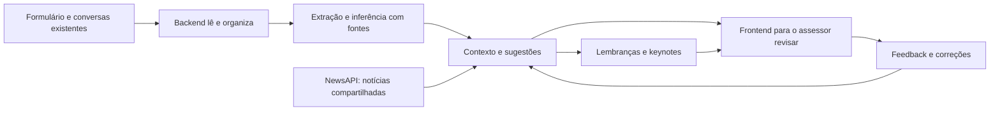
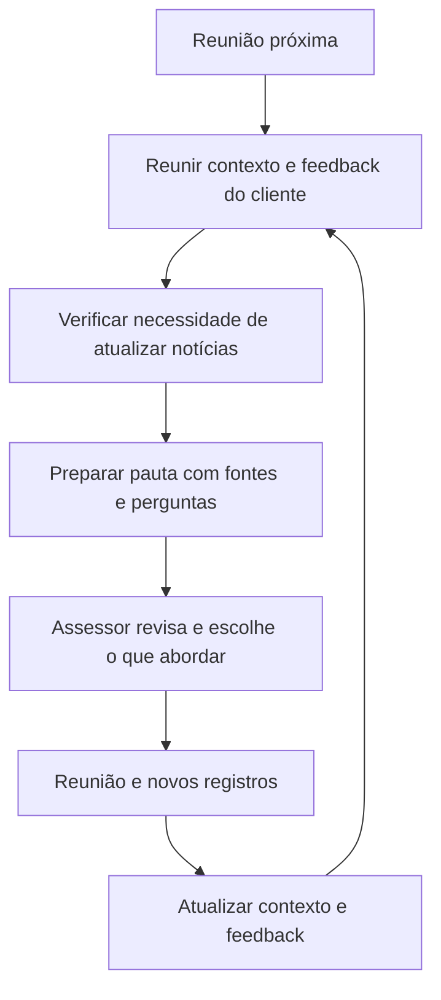

# Como o sistema vai funcionar

**Em uma frase:** transformar informações que já existem sobre o investidor em
contexto, lembranças e preparação de reuniões, com decisão final do assessor.

**Estado atual:** base de consulta e acompanhamento implementada em Flask, SQLite,
JavaScript e Tailwind. Extração Gemini com evidências e revisão humana implementadas;
125 testes; chamada real com quatro fontes fictícias gerou sete propostas.
Lembranças derivadas, notícias e reuniões são evolução.
**Atualizado em:** 10/10/2026. Acesso à fonte real pendente; modelo configurável.

**Propósito:** poupar tempo do assessor e melhorar sua relação com o investidor.
Ele mantém a decisão profissional e a condução do relacionamento.
**Diferencial proposto:** contexto de conversas e formulário com evidências,
revisão preservada e preferências por cliente. Exclusividade no mercado não
foi verificada; benefícios ainda precisam ser medidos.

A base já permite listar clientes, consultar resumo por template, registrar
interações manualmente, avaliar relacionamento, ajustar preferências e tratar
alertas de vencimento/aniversário. [Execução local](../README.md).
Também importa formulário/conversas de JSON fictício, preserva versões e
separa identidades pendentes. Essa entrada simulada não é uma conexão aos canais reais.

## Nosso ponto de partida

Já existe um local com:

- Transcrições de ligações.
- E-mails e mensagens de WhatsApp Business.
- Formulário que o investidor preencheu no início do relacionamento.

Assumimos que esses dados estarão disponíveis. Precisamos combinar como lê-los
e identificar a qual cliente pertencem. A demonstração pode usar uma fonte fictícia
com o mesmo formato. Criar o formulário ou capturar os canais não é a tarefa central.

## O que fazemos com esses dados

1. **Ler:** receber novos registros e alterações sem duplicar o histórico.
2. **Entender:** extrair objetivos, interesses, preferências, datas e compromissos.
3. **Explicar:** mostrar evidências e distinguir fatos de hipóteses.
4. **Sugerir:** lembrar o que pode importar agora e preparar pautas de reunião.
5. **Revisar:** assessor aprova, corrige, adia ou descarta.
6. **Melhorar:** guardar feedback e aplicá-lo nas próximas sugestões.

## Exemplo rápido

**Dados fictícios:** no formulário, Mariana informa aniversário em 12/10. Em uma
conversa, diz que acompanha Fórmula 1. Em outra, comenta o aniversário da filha.

O sistema pode:

- Extrair a data de Mariana com referência ao campo do formulário.
- Sugerir Fórmula 1 como interesse, mostrando a conversa que deu origem à sugestão.
- Identificar que a terceira informação é sobre a filha, mantendo a data incerta
  se a conversa não indicar dia e mês.
- Preparar um lembrete e uma possível notícia para o assessor avaliar.

O assessor confirma o interesse, corrige uma inferência ou marca uma notícia
como irrelevante. O sistema preserva a correção e evita repetir aquela sugestão.
Se ele indicar “não abordar Fórmula 1 com esta cliente”, o assunto deixa de
aparecer nas sugestões pessoais dela até nova revisão.

## Frontend: o que o assessor vê

| Tela | Conteúdo e ações |
| --- | --- |
| Visão geral | Clientes que precisam de atenção, sugestões e reuniões próximas |
| Cliente | Formulário, histórico, contexto extraído, fatos confirmados e hipóteses |
| Revisão | Evidência de cada sugestão; aprovar, corrigir, descartar ou adiar |
| Lembranças e alertas | Aniversários, combinados, notícias e vencimentos quando houver dados |
| Reunião | Keynotes, fontes, dúvidas a confirmar, notas próprias e próximos passos |

Proposta inicial: web responsiva no computador e celular. Aplicativo separado
continua uma possibilidade de evolução. O assessor mantém a decisão de contato;
lembranças não enviam mensagens automaticamente ao investidor.

## Backend: o que acontece por trás

| Parte | Função |
| --- | --- |
| Adaptador da fonte | Lê registros existentes e identifica cliente, origem, data e versão |
| Extração e inferência | Gemini configurável via REST; propostas pendentes e evidências literais validadas |
| Banco de contexto | Guarda fontes, fatos, hipóteses, revisões, lembranças e feedback |
| Regras de pertinência | Consideram preferências, atualidade, pendências e feedback |
| Agendador e NewsAPI | Atualizam assuntos diariamente e antes de reuniões quando necessário |
| API | Entrega dados às telas e valida ações de revisão |

A fonte guarda o registro original. O contexto organiza o que entendemos dele.
O feedback registra o que o assessor validou, corrigiu ou considerou pertinente.
Essas três camadas precisam continuar distinguíveis.

## Feedback: melhorar sem retreinar um modelo

| Ação | Efeito esperado |
| --- | --- |
| Informação correta | Confirma o item com autoria e data |
| Informação incorreta | Corrige o contexto, preservando a fonte e a revisão |
| Lembrança relevante | Ajuda a priorizar sugestões semelhantes para esse cliente |
| Irrelevante nesta ocasião | Evita repetir o item sem apagar um interesse verdadeiro |
| Não abordar este assunto | Bloqueia sugestões do assunto para o cliente escolhido |
| Adiar | Reapresenta a pendência na data combinada |

No MVP, esse aprendizado pode ser feito com decisões persistidas, regras e
contexto enviado à IA. Falta de resposta não significa aprovação ou rejeição.

## Reunião próxima: os keynotes

A pauta curta reúne:

- Objetivo do encontro e situação conhecida do investidor.
- Últimos combinados e perguntas ainda abertas.
- Alertas financeiros com dados e regras disponíveis.
- Datas, interesses e notícias pertinentes ao contexto revisado.
- Hipóteses que precisam de confirmação, claramente identificadas.
- Fontes, atualização e espaço separado para notas do assessor.

Atualizar pauta preserva notas e correções humanas. Em caso de falha no NewsAPI,
continuam disponíveis as informações internas com indicação da limitação.

## Como controlar custo e excesso de lembretes

- Processar registros novos ou alterados, reutilizando extrações já revisadas.
- Buscar notícia por assunto, compartilhando resultados entre clientes.
- Usar cache e cota para atualizações diárias e preparação de reuniões.
- Filtrar preferências, validade e feedback antes de gerar sugestões.
- Limitar quantidade de sugestões e evitar repetir itens já tratados.

As janelas de 24h para reunião e 2h para cache continuam propostas. Plano, atraso
e limites do provedor estão em [busca de notícias](integracoes/busca-noticias.md).

## Decisões e próximos passos

| Tema | Situação |
| --- | --- |
| Formulário e fonte de conversas já existem | Premissa confirmada pelo usuário |
| Inferir contexto dessas fontes | Núcleo confirmado |
| Lembranças, revisão final humana e feedback | Incluídos no planejamento |
| NewsAPI, atualização diária e keynotes | Direção definida; parâmetros pendentes |
| Stack | Flask + SQLite + JavaScript + Tailwind definidos |
| Modelo de IA | Gemini configurável; extração real validada em uma amostra fictícia |
| Contrato da fonte e acesso | JSON fictício definido; fonte real pendente |
| Funcionalidades implementadas | Consulta, interações manuais, preferências, relacionamento e alertas |
| Entrada simulada de fontes | JSON fictício, versões, histórico e pendências implementados |
| Contexto e revisão | Extração, quatro ações, possíveis conflitos e bloqueio individual implementados; 125 testes; visual parcial |

**Ordem de construção proposta:** consumir fonte → extrair contexto → revisar e
aplicar feedback → sugerir lembranças/notícias → preparar reunião → validar o ciclo.

Detalhes: [requisitos](planejamento/requisitos.md) e
[contexto e feedback](integracoes/contexto-investidor.md).
Atualizar este quadro e os diagramas quando houver novas decisões da equipe.
