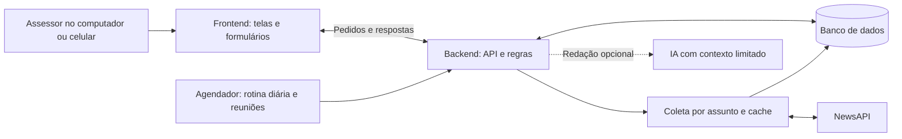
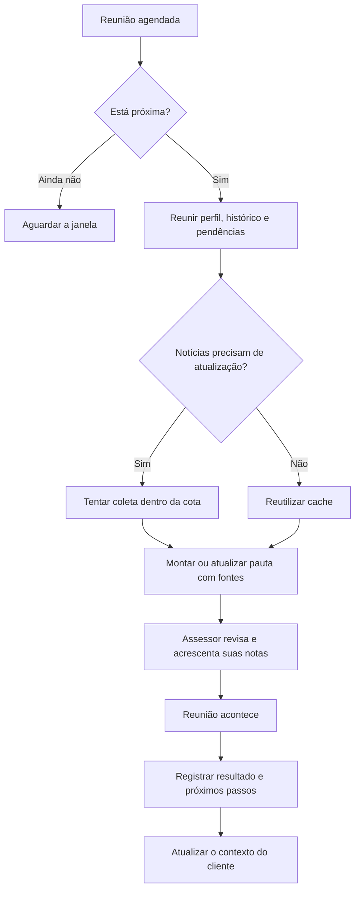

# Como o sistema vai funcionar

**Em uma frase:** ajudar o assessor a saber quem precisa de atenção, entender
o contexto e chegar preparado para conversar com cada investidor.

**Estado atual:** planejamento, sem aplicação implementada.
**Atualizado em:** 10/10/2026. Stack e parâmetros de alertas continuam pendentes.

## O que o assessor faz

1. Abre o painel e vê clientes com pendências e reuniões próximas.
2. Escolhe um cliente e consulta perfil, objetivos, histórico e preferências.
3. Entende os alertas e abre a fonte de cada informação.
4. Antes da reunião, lê os **keynotes**: uma pauta curta de preparação.
5. Depois da conversa, registra resultado e próximos passos.

## Frontend: a parte que o assessor vê

| Tela | Conteúdo e ações |
| --- | --- |
| Visão geral | Prioridades, pendências e reuniões próximas |
| Clientes | Busca, filtros e acesso ao detalhe |
| Detalhe do cliente | Perfil, objetivos, posições, preferências, resumo e interações |
| Alertas | Motivo, origem, data e ação para marcar como tratado |
| Reunião | Data, objetivo, keynotes, notas do assessor e registro do resultado |

Proposta inicial: site responsivo para computador e celular, com os mesmos
dados. Aplicativo separado é uma possibilidade de evolução.

## Backend: a parte que organiza e garante as regras

- **API:** recebe pedidos da interface, valida e consulta/grava informações.
- **Banco:** guarda clientes, conversas, preferências, reuniões, pautas e alertas.
- **Regras:** calculam vencimentos, prioridades e quais eventos são pertinentes.
- **Agendador:** dispara atualização diária e preparação antes das reuniões.
- **Coletor de notícias:** consulta NewsAPI e reutiliza resultados por assunto.
- **Preparação da pauta:** combina contexto e fontes; IA pode ajudar a redigir.

O frontend pede dados ao backend. O backend consulta o banco e aplica as regras.
Uma chamada de API é essa troca de pedido e resposta. A chave do NewsAPI fica
no backend; a tela recebe apenas os resultados necessários.

## Reunião se aproximando: os keynotes

O sistema identifica uma reunião próxima e reúne uma pauta:

- **Objetivo:** o que se pretende resolver nesse encontro.
- **Contexto:** situação registrada e objetivos do cliente.
- **Pendências:** combinados anteriores e dúvidas sem resposta.
- **Financeiro:** vencimentos e alertas com regras definidas.
- **Relacionamento:** preferências, cuidados e assuntos pessoais pertinentes.
- **Perguntas:** sugestões do que confirmar com o cliente.
- **Fontes:** de onde veio cada fato e quando foi atualizado.

Falha na busca mantém a pauta com o contexto interno e indica a limitação.
Novas informações atualizam a parte gerada e preservam as notas do assessor.
Reagendar recalcula o momento de preparação; cancelar interrompe os disparos.

**Exemplo fictício:** Mariana tem reunião amanhã, um ativo vencendo e interesse
em Fórmula 1. A pauta lembra o objetivo financeiro, o vencimento e uma pergunta
sobre a dúvida anterior. Uma notícia pode sugerir um assunto pessoal, se ela
aceitar esse tipo de contato. Depois, o assessor registra o que foi combinado.

## Atualizar sem gastar uma busca por cliente

- Buscar cada assunto uma vez e compartilhar os resultados pertinentes.
- Fazer coleta diária; antecipar antes da reunião somente se necessário.
- Guardar resultados em cache: uma cópia reutilizável com data de atualização.
- Repetir a consulta não deve duplicar notícias nem alertas.
- Gerar nova pauta quando seus dados mudarem; reutilizar a versão válida.
- Um especialista de IA pode resumir conteúdo filtrado; horário e orçamento
  seguem regras do backend.

Janelas de 24h para reunião e 2h para cache são **propostas**, não decisões fechadas.
Os limites do plano e a defasagem das notícias estão em
[busca de notícias](integracoes/busca-noticias.md).

## Como interpretar os indicadores

| Indicador | O que significa |
| --- | --- |
| Perfil financeiro | Características registradas do investidor |
| Relacionamento | Positivo, negativo ou atenção, com evidência e avaliação |
| Prioridade | Urgência de acompanhamento a partir das pendências |
| Oportunidade pessoal | Assunto possível para contato, respeitando preferências |

Notícia sobre um time pode virar oportunidade de conversa. Não comprova humor
nem altera o perfil financeiro. NewsAPI também não substitui dados de carteira
ou regras validadas para análises tributárias.

## Construção por partes

1. Clientes e consulta de dados persistidos.
2. Interações, preferências e resumo factual.
3. Alertas de vencimento e notícias pertinentes.
4. Reuniões e keynotes com fontes e revisão.
5. Integração, testes, instruções e demonstração.

Detalhes e aceite: [requisitos](planejamento/requisitos.md).

## Registro rápido de decisões

| Tema | Situação |
| --- | --- |
| Documentação antes do código | Confirmado pelo usuário |
| NewsAPI como fonte de notícias | Confirmado pelo usuário |
| Atualização diária e antecipação por reunião | Direção definida; parâmetros pendentes |
| Keynotes antes de reuniões | Incluídos no planejamento |
| Web responsiva como primeira interface | Proposta |
| Stack, IA, autenticação e integrações de canais | Pendentes |
| Funcionalidades implementadas | Nenhuma nesta pasta |

Atualizar este quadro e os diagramas quando a equipe mudar uma decisão.
